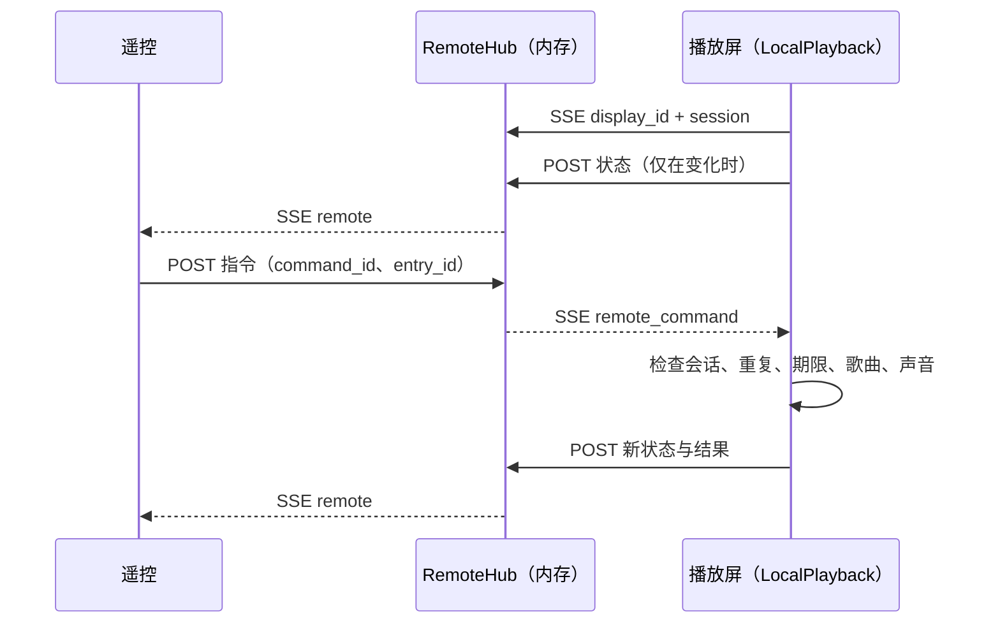

# 遥控设计

一台设备接电视播放，手机或平板控制它。点歌、置顶和移除未唱的歌本来就是共享的，遥控补上播放控制。使用方法见 [APP](../../APP.md#用手机或平板遥控)，接口见 [API](../../API.md#遥控)。

## 不变量

1. 未主动允许遥控的设备，任何远程操作都不能影响它。
2. 播放状态只有一个权威，即播放屏的 `LocalPlayback`。服务端只转发，不推进播放时钟，不裁决播放状态。
3. 遥控端不出声：不创建 `AudioContext`，不加载音轨和 MV，不取得 `PlaybackTabs` 所有权，不写播放进度。主动打开的预览除外。
4. 过期的指令不执行，重复送达的指令只生效一次，针对旧歌的指令无效。
5. 遥控故障不影响演唱和点歌。
6. 状态只在变化时上报，空闲时没有流量。

## 结构

- 复用 `/v1/room/events`，不增加长连接：播放屏高峰时已有约 5 条连接，HTTP/1.1 同源通常上限为 6。
- 每条 SSE 有自己的队列，可以单独唤醒，不广播。`RoomFeed.frame()` 在该连接已有最新房间状态时不再重发快照。
- 后端放在 `room.py`。新建 `karaoke/*.py` 会改变 `pipeline_fingerprint()`，使已完成歌曲的处理版本改变。
- 不采用服务端权威：那样任何设备的操作都会作用于全部设备，缓冲、就绪握手和混音也要经过服务端。

## 播放屏

- 「遥控」开关默认关闭，按浏览器记忆。只有拥有播放权的标签页注册，会话直接用 `PlaybackTabs` 的会话标识；移交后旧会话的状态和指令都被拒绝。关闭开关后立即停止执行指令，最多 3 秒后从列表消失。
- 指令逐条执行，以 `claim=false` 调用现有 `command()`，不会抢占其他标签页。
- `locked` 只看 `AudioContext.state`。没有声音时拒绝 `play`、`restart`、`next`、`seek`，避免没唱就切走歌曲；`pause`、`remove`、`lead`、`pitch` 不需要声音，照常执行。不调用会等待手势的 `unlock()`，原因见下文。
- 上报失败按 1、2、4…30 秒退避重试，期间的画面刷新不会触发重发；SSE 重连后立即重新上报。
- 换歌会重建 SSE，3 秒内不算离线。

## 遥控页

- 由 `/?remote=1` 进入。`RemoteControl` 提供与 `LocalPlayback` 相同的形状，沿用现有控件。
- 一台播放屏时自动选中。选定后不自动改选，所选播放屏断开就禁用播放控件。
- 操作先显示目标值。3 秒内没有结果就恢复实际值并提示，不伪装成已成功。
- 歌曲信息按 `entry_id`／`job_id` 从房间快照取，状态里不带文字和链接。

## 浏览器行为实测

M1 MacBook Air，2026-11-25，Safari 27.2 与 Chrome 158 各一轮，全屏、前台、不休眠。测试台从服务端下发指令，在页面里触发真实控件的 `click()`，不产生用户激活；旁路读取送往扬声器的信号电平。最后一次真实手势在首条指令前约 9 秒（Safari）、15 秒（Chrome），之后到序列结束没有手势。

| 场景 | Safari | Chrome |
|---|---|---|
| 暂停、继续、定位、重唱、下一首 | 生效，有画面和信号 | 同左 |
| 主唱开关、升降调 | 生效，播放未中断 | 同左 |
| 暂停 10 分钟后继续，再下一首 | 生效，`AudioContext` 一直 `running` | 同左 |
| 唱到结尾 | 自动接唱 | 同左 |
| 播放中刷新 | 无声；`resume()` 不拒绝，一直挂起 | 自动从原位置续播 |

Chrome 的自动续播取决于该站点的使用记录，不作为依据。Safari 刷新后没有手势，`navigator.userActivation.hasBeenActive` 仍会变为真，也不能用来判断。

未覆盖：显示器休眠、合盖、HDMI 拔插、后台标签页、更长时间的暂停。
